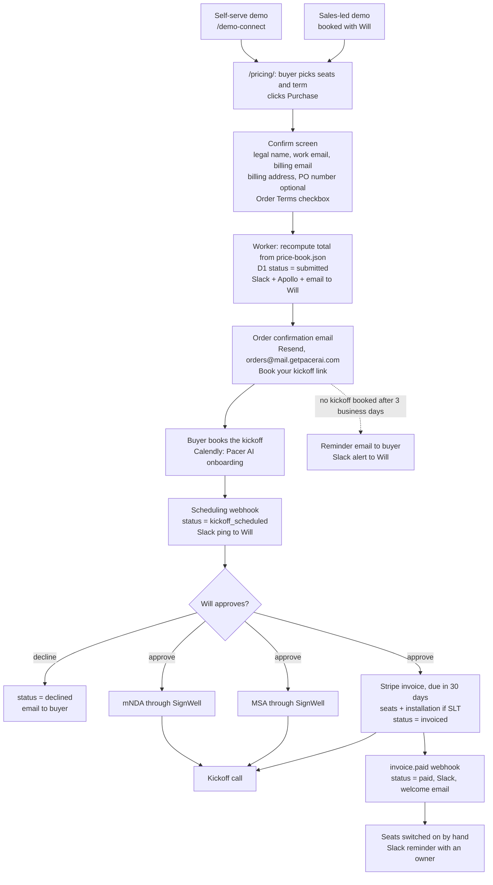

# Purchase process: demo, purchase, kickoff, approval, paperwork

**Status:** Agreed with Will on 2026-11-10. Steps 2 and 3 ship with the pricing page (PAC-164). PAC-260 holds the rest.
**Date:** 2026-11-10
**Related:** [PAC-260](https://linear.app/getpacerai/issue/PAC-260/purchase-flow-send-msa-mnda-and-stripe-invoice-when-the-kickoff-is) (Stripe and paperwork, the source of these decisions), PAC-164 (pricing page v2.0), `docs/lead-capture-architecture.md`

## Summary

The buyers are CROs and CFOs at $50M–$1B companies. They pay by invoice, ACH or PO, and they expect an MSA and an NDA. So the site takes no card payment. Stripe Invoicing sends the invoice, and Will approves every order until there are about five customers.

1. **Demo.** Self-serve (`/demo-connect`) or sales-led with Will.
2. **Purchase.** The buyer picks seats on `/pricing/` and clicks **Purchase**. A confirm screen collects the billing details.
3. **Order confirmation.** A Resend email confirms the order and carries the link to book the kickoff.
4. **Kickoff booked.** The scheduling webhook marks the order and pings Will.
5. **Will approves**, or declines, which emails the buyer.
6. **Paperwork goes out before the call:** mutual NDA and MSA through SignWell, and the Stripe invoice.
7. **Paid.** `invoice.paid` marks the order and sends the welcome email.
8. **Seats switched on** by hand at first. The platform repo owns this step.

## The flow

## Steps

### 1. Demo

Both paths exist today: `/demo-connect` (Try the Demo Free) and a demo booked with Will. Nothing changes here.

### 2. Purchase (ships with the pricing page)

- The pricing page button reads **Purchase**, replacing "Choose these seats". It opens the confirm screen, the Worker's `/order` card.
- The confirm screen shows seats, term and total, recomputed from `price-book.json`.
- Fields: company legal name, work email, name, billing email (defaults to the work email), billing address (street, city, state or region, postal code, country), and an optional PO number.
- An Order Terms checkbox: "I agree that this order is governed by the Pacer AI Master Services Agreement, sent for signature before the kickoff." It links to the MSA once Price has drafted it.
- Button: **Purchase**. The note under it: "No payment is taken here. Will reviews every order. Your MSA, mutual NDA and invoice arrive before your kickoff."
- The Worker recomputes the total and never trusts the page. It saves the order to D1 with status `submitted` and the billing details, then posts to Slack, adds the Apollo contact and emails Will, as today.

### 3. Order confirmation email (ships with the pricing page)

Sent through Resend from `orders@mail.getpacerai.com`, reply-to Will:

- subject: "Your Pacer AI order: {seats}";
- the order table: seats, term and total, plus the billing details as entered;
- one button: **Book your kickoff**, linking to `https://calendly.com/pacerai/pacer-ai-onboarding`, with the buyer's name and email pre-filled and the order ID in `utm_content`;
- the line: "Will reviews every order. Your MSA, mutual NDA and invoice arrive before your kickoff."
- a W-9 link for vendor setup, once the W-9 is hosted (PAC-260).

### 4. Kickoff booked

The scheduling tool's webhook reaches the Worker. It checks the signature, matches the booking to the order by `utm_content` (falling back to the email), sets `kickoff_scheduled`, and pings Will in Slack. Calendly webhooks need a paid plan; until then, Calendly's own email tells Will.

### 5. Will approves

Approve or decline in Slack or by a signed, single-use, expiring link. A decline sets `declined` and emails the buyer.

### 6. Paperwork, ahead of the call

- **Mutual NDA** through SignWell, from the Pacer AI NDA template (the send-nda workflow).
- **MSA** through SignWell. Price owns the document. It is also the Order Terms the checkbox points to.
- **Invoice:** the Worker creates the Stripe Customer and Subscription with collection method "send invoice", `days_until_due: 30`, the PO number as an invoice custom field, and Stripe Tax on. Stripe emails the invoice, and its hosted page takes card or ACH. An SLT order adds the $5,000 installation to the first invoice as a one-time item. Status: `invoiced`.

### 7. Paid

The `invoice.paid` webhook checks the signature, sets `paid`, posts to Slack and sends the welcome email. ACH takes a few days, so `processing` shows in between. `invoice.payment_failed` sets `payment_failed`, and an invoice past due sets `overdue`. Both post to Slack.

### 8. Seats switched on

By hand at first, in the platform repo. Each paid order creates a Slack reminder with an owner.

## Order status in D1

`submitted` → `kickoff_scheduled` → `approved` → `invoiced` → (`processing`) → `paid`. Off the main path: `declined`, `payment_failed`, `overdue`.

## Decisions (Will, 2026-11-10; recorded in PAC-260)

- **Approval:** Will approves every order until there are about five customers. A decline emails the buyer.
- **12-month terms are billed up front:** $1,000 (Rep pacing), $5,000 (Manager pacing) and $10,000 (SLT pacing and planning) per seat per year. Monthly billing is for month-to-month terms only, so there are no fractional cents.
- **SLT installation ($5,000):** listed on `/pricing/` under services, as built. It is added to the first invoice as a one-time item after Will approves.
- **Order Terms:** the checkbox points to the Pacer AI MSA. Price drafts it, and it may need a lawyer.
- **Sales tax:** Stripe Tax on from the start. The confirm screen collects the billing address.
- **Payment terms:** due in 30 days. The PO number prints on the invoice.
- **E-signature:** SignWell.
- **Generator:** `scripts/build_pricing.py` stays. It writes the page and `price-book.json`, and the Stripe price-ID map sits next to `price-book.json`, checked so that every seat has a Stripe price.

## What gets built

| Piece | Where | When |
|---|---|---|
| Purchase button | `src/pricing/pricing-template.html`, `src/pricing/pricing.js` | Built on the PAC-164 branch. Not deployed. |
| Confirm screen: billing fields, PO, Order Terms checkbox | `infra/pacer-demo-worker/src/order.ts` | Built on the PAC-164 branch. Not deployed. |
| Order confirmation email with the Book your kickoff link | `src/order.ts` `sendEmails` | Built on the PAC-164 branch. Not deployed. |
| D1: status `submitted`, legal name, billing email and address, PO, terms accepted | `migrations/0006_orders.sql` | Written. Not applied to remote D1. |
| Scheduling webhook, approve and decline routes | new Worker routes | PAC-260 |
| SignWell send for the mNDA and MSA | new Worker module | PAC-260 |
| Stripe: Customer, Subscription, installation item, Tax, webhooks with idempotency | new Worker module | PAC-260 |
| Seat → Stripe price ID map | next to `src/price-book.json` | PAC-260 |
| Reminder after 3 business days | Worker cron | PAC-260 |

**Until PAC-260 lands, steps 4 to 8 are done by hand.** Calendly emails Will when a kickoff is booked. Will sends the NDA and MSA from SignWell and creates the invoice in the Stripe dashboard. The buyer sees the same thing either way.

## Still open

- The MSA itself (Price drafts; may need a lawyer).
- A hosted W-9 for the confirmation email.
- Will sets the Stripe account, the `STRIPE_SECRET_KEY` Worker secret and the webhook signing secret himself.
- The Price Book says a 12-month contract is "billed monthly", and the pricing page repeats that. Billing the year up front changes that line, so it needs a Price Book edit by Will.
